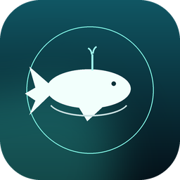

  

<h1 align="center">WhalePaper · 鲸鱼壁纸</h1>

把本地图片、GIF 和视频放到 Windows 桌面上。离线使用，无账号、无遥测。

  <a href="https://github.com/adihe1819/WhalePaper/releases/latest">下载最新版</a> ·
  <a href="docs/testing.md">验证记录</a> ·
  <a href="https://github.com/adihe1819/WhalePaper/issues">反馈问题</a>

WhalePaper 是一个 Windows 本地壁纸工具。导入自己的媒体文件，选中后应用为壁纸；动态画面在桌面图标后方播放。关闭主窗口后，程序留在系统托盘，可以随时暂停、继续或退出。

**English:** A local Windows wallpaper app for images, animated GIFs and videos. Offline, no account and no telemetry. Built with C#, WPF, Win32 and Windows Media Foundation.

## 可以做什么

- 导入文件或把文件拖进窗口，管理本地壁纸库。
- 使用图片、GIF 或视频作为壁纸，选择填充、适应、拉伸等显示方式。
- 在托盘中暂停、继续和退出；可选择登录后启动。
- 静态图片交给 Windows 显示；动态播放失败时保留静态海报。
- 壁纸、缓存、设置和日志保存在本机；导入会复制文件，删除库内条目不会删除原文件。

当前版本为 **1.0.7**。视频循环、暂停与恢复、桌面图标可见和可选中，已在 Windows 11 25H2 上实测。完整范围见[验证记录](docs/testing.md)。

## 下载与使用

从 [Releases](https://github.com/adihe1819/WhalePaper/releases/latest) 下载：

| 文件 | 用途 |
| --- | --- |
| WhalePaper-Setup-1.0.7-x64.exe | 安装版 |
| WhalePaper-1.0.7-portable-x64.zip | 免安装版 |
| SHA256.txt | 发布包校验值 |

安装版运行安装程序后启动“鲸鱼壁纸”。免安装版先解压到可写文件夹，再运行 **WhalePaper-portable.cmd**，数据会保存在旁边的 data 文件夹。

1. 点击“导入壁纸”，或把文件拖入窗口。
2. 选中壁纸，选择显示方式，再点击“应用为壁纸”。
3. 关闭主窗口后，从系统托盘控制播放或退出。
4. 如需退出时恢复原壁纸，在设置中开启对应选项。

运行需要 **64 位 Windows 10/11 和 .NET Framework 4.8**，用户无需安装 .NET SDK。当前以 Windows 11 为主要适配平台；Windows 10 尽力兼容，未完成同等验收。安装包尚未进行代码签名，可将下载文件的 SHA-256 与同次发布的 SHA256.txt 核对。

~~~powershell
Get-FileHash .\WhalePaper-Setup-1.0.7-x64.exe -Algorithm SHA256
~~~

## 支持格式与限制

| 类型 | 格式 |
| --- | --- |
| 图片 | JPG、JPEG、PNG、BMP、TIFF；WebP 依赖系统图像解码器 |
| 动图 | GIF |
| 视频 | MP4、M4V、WMV、AVI、MOV；实际支持取决于 Windows Media Foundation 解码器，建议先试 H.264 MP4 |

- 视频目前静音，尚无音频输出；绘制最高 30fps，按媒体时间戳播放。
- 动态画面目前只在主显示器播放；尚不支持每屏独立动态壁纸。
- 不支持 HTML/WebGL、Wallpaper Engine 私有格式或 DRM 视频。
- 应用动态壁纸时，主窗口可能短暂隐藏数秒，用于检查桌面挂载和实际像素。
- 全屏、锁屏、电池、远程会话等自动暂停逻辑已经存在，但这些场景及 Explorer 重启尚未完整验收。安装、升级、卸载同样需要进一步人工验证。
- 桌面挂载依赖 Windows 桌面窗口行为，系统更新或第三方桌面工具可能影响兼容性。

## 数据与隐私

应用本身不发起网络请求，不上传壁纸，不收集使用数据。构建、下载发布包和 GitHub 服务会涉及网络访问。

| 内容 | 默认位置 |
| --- | --- |
| 壁纸库 | %LocalAppData%\WhalePaper\Library |
| 缓存 | %LocalAppData%\WhalePaper\Cache |
| 日志 | %LocalAppData%\WhalePaper\Logs |
| 设置 | %LocalAppData%\WhalePaper\settings.json |

免安装启动脚本使用程序旁的 data 文件夹；开发和测试可通过 --data-dir 指定独立目录。反馈前请检查日志和截图，移除个人路径、媒体名称和桌面信息。排查步骤见[故障排查](docs/troubleshooting.md)。

## 从源码构建

在 Windows 上安装 [.NET 10 SDK](https://dotnet.microsoft.com/download/dotnet/10.0)，然后在仓库根目录运行：

~~~powershell
.\setup.ps1
~~~

这会检查已有 SDK，并构建应用和桌面测试程序，不安装软件。Windows Git Bash 中也可运行：

~~~sh
bash setup.sh
~~~

生成的应用位于 src/WhalePaper/bin/Release/net48/WhalePaper.exe。使用便携 SDK 时，可传入可执行文件位置：

~~~powershell
.\setup.ps1 -DotNetPath 'D:\dev-tools\dotnet\dotnet.exe'
~~~

制作免安装包：

~~~powershell
.\build.ps1 -SkipInstaller
~~~

制作安装版还需要单独准备 [Inno Setup](https://jrsoftware.org/isinfo.php)：

~~~powershell
.\build.ps1 -InnoSetupCompiler 'D:\dev-tools\Inno Setup 6\ISCC.exe'
~~~

也可同时传入 -DotNetPath。发布包输出到 dist。构建工具与用户运行时不同：SDK 用于编译，应用仍以 .NET Framework 4.8 为目标。

## 项目结构

~~~text
src/WhalePaper/   WPF 界面、壁纸库、Win32 桌面宿主和媒体播放
installer/        Inno Setup 安装脚本及简体中文语言文件
tools/            可选的素材与测试样例生成脚本
tests/            媒体回归脚本、交互式桌面测试程序
docs/             架构、验证和故障排查说明
LICENSES/         随附第三方许可证
~~~

[架构说明](docs/architecture.md)解释了媒体与桌面窗口之间的关系。[测试说明](docs/testing.md)给出了回归命令。GitHub Actions 只编译和检查打包，不代表交互式桌面测试通过。

欢迎提交 Issue 和 Pull Request，参见[贡献指南](CONTRIBUTING.md)。

## 许可证

项目代码与原创资源使用 [MIT 许可证](LICENSE)。第三方组件和文件适用各自许可证，见 [THIRD-PARTY-NOTICES.txt](THIRD-PARTY-NOTICES.txt) 及 LICENSES。自行导入的壁纸不随项目发布，其权利仍属于原作者。

