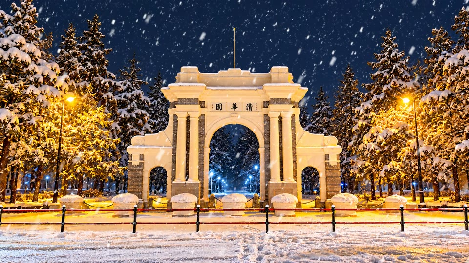

# 壁纸素材

这些 MP4 作为 [v1.0.8 Release](https://github.com/adihe1819/WhalePaper/releases/tag/v1.0.8) 附件单独提供，不放进 Git 历史，也不捆绑进安装包。下载后通过鲸鱼壁纸的“导入壁纸”添加。

## 清华园雪夜

[下载 Tsinghua-Snow-2K-120fps.mp4](https://github.com/adihe1819/WhalePaper/releases/download/v1.0.8/Tsinghua-Snow-2K-120fps.mp4)

- 2560×1440，120fps，30 秒静音循环。
- 基于提供的雪景图制作，背景经过局部 AI 修复，从原图提取雪迹后重建分层下落。
- 文件大小：450845760 字节。
- SHA-256：`a059da285bd6420b1a7a317b3790aaaa64cc82b799b0984abd765ce676f0145c`

## 月下动漫人物

[下载 Moonlight-Anime-2K-60fps.mp4](https://github.com/adihe1819/WhalePaper/releases/download/v1.0.8/Moonlight-Anime-2K-60fps.mp4)

- 2560×1440，60fps。
- 保留的既有动漫壁纸素材；此处使用画面描述命名，不推定角色名或宣称原创。
- 文件大小：18430328 字节。
- SHA-256：`4f8a6978f457866b3f3f0b90ccbde3cf2b23ea4236d9e35fc446594bb4a4a719`

## 使用与许可

两份素材经提供者授权在本项目中公开下载，素材的权利仍属于各自权利人，不自动适用项目代码的 MIT 许可证。

实际流畅度取决于本机解码和绘制能力。高帧率素材持续解码不足时，优先使用适合设备的 60/120fps 版本。若希望切回桌面时始终持续播放，可关闭“全屏应用时暂停”；其他暂停策略仍独立生效。
